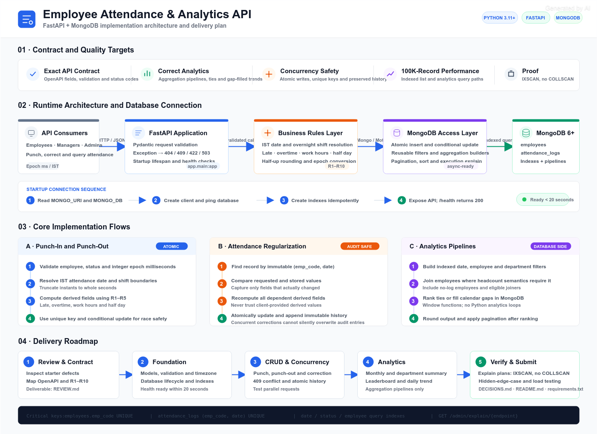

# Employee Attendance & Analytics API

[](https://fastapi.tiangolo.com)
[](https://www.mongodb.com/)
[](https://www.python.org/)
[](https://swagger.io/specification/)
[]()

A production-grade REST API backend for an enterprise Employee Attendance & Analytics system built for **HROne**. Fully compliant with the official **OpenAPI 3.0.3** specification, enforcing database-level atomicity, handling high-concurrency punch events, and executing complex analytics directly inside MongoDB aggregation pipelines.

---

## 🏗️ System Architecture



### Key Architectural Highlights:
1. **5-Layer Architecture:** Clean separation across HTTP Routing, Pydantic Schema Validation, Business Logic Helpers, MongoDB Access, and MongoDB 7.0 Storage Engine.
2. **Database-Level Atomicity:** Unique compound index on `(emp_code, date)` acts as an unbreachable race-condition guard against concurrent punch-ins.
3. **Optimized Aggregation Pipelines:** Multi-stage MongoDB pipelines replace in-memory Python loops for monthly analytics, cross-collection department lookups, and rolling trends.
4. **Idempotent Startup:** Auto-generates all 7 compound performance indexes on application launch.

---

## 🚀 Business Rules Implemented (R1 – R10)

| Rule | Description | Implementation |
|---|---|---|
| **R1** | **IST Timezone & Overnight Rollover** | Dates in IST (+5:30). Punches before `shift_end` on overnight shifts (e.g. 22:00–06:00) map to previous day. Instants truncated to whole seconds. |
| **R2** | **Late Arrival (10-min Grace)** | Late only if `punch_in > shift_start + 10:00` (600s). Then `late_minutes = floor((punch_in - shift_start)/60)` from shift start. |
| **R3** | **Overtime (30-min Minimum)** | Overtime = floor of minutes past `shift_end`, counted only if $\ge$ 30 minutes; otherwise 0. |
| **R4** | **Work Hours (Half-Up)** | $(punch\_out - punch\_in) / 3600$, rounded to 2 decimal places using `ROUND_HALF_UP`. Null until punch-out. |
| **R5** | **Half-Day Threshold** | `half_day = True` when rounded `work_hours < 4.50`. Counts as 0.5 present day in attendance calculations. |
| **R6** | **Presence Counting** | `PRESENT`, `WFH`, `ON_DUTY` count as present. `ABSENT`, `LEAVE` do not. |
| **R7** | **Working Days** | Monday through Friday only (no holiday calendar). Filtered from `joined_on` for mid-month joiners. |
| **R8** | **Reporting Precision** | Quantities rounded to 2 decimals half-up; percentages and rates rounded to 4 decimals half-up. |
| **R9** | **Department Headcount** | Employees with `joined_on <= period_end`, including employees with zero attendance records. |
| **R10**| **Database Pagination** | 1-indexed page, default `page_size = 20` (max 100), total count calculated before skip/limit. |

---

## 📡 API Endpoints (All 12 Implemented)

### Operational Endpoints
* `GET /health` — Health check with live MongoDB ping (200 OK / 503 Service Unavailable).
* `POST /employees` — Create employee with regex validation & duplicate prevention (201 / 409 / 422).
* `GET /employees` — Paginated employee directory with department filters and `emp_code ASC` sorting.
* `POST /attendance/punch-in` — Create attendance record with IST rollover, late minutes, and race safety (201 / 409 / 422).
* `POST /attendance/punch-out` — Clock out with auto-computed work hours, half-day status, and overtime (200 / 409 / 422).
* `GET /attendance` — Multi-filter attendance queries backed by compound database indexes.
* `PATCH /attendance/{emp_code}/{date}` — HR regularization recomputing derived fields and appending to `history[]` audit log.

### Business Analytics Endpoints (MongoDB Pipelines)
* `GET /analytics/employees/{emp_code}/monthly` — Monthly summary for one employee (presence days, late count, total hours).
* `GET /analytics/departments/summary` — Cross-collection aggregation (`$lookup`) calculating active headcount and attendance %.
* `GET /analytics/leaderboard/late` — Late-comers leaderboard using **Standard Competition Ranking (1, 2, 2, 4)** with tie handling.
* `GET /analytics/departments/{department}/trend` — Daily attendance series with gap filling (`$densify`) and rolling 7-day moving average.
* `GET /admin/explain/{endpoint}` — Returns `executionStats` query plan proving **`IXSCAN`** execution across 100k records.

---

## 📑 Project Documentation Links

* [**`REVIEW.md`**](REVIEW.md) — Part A Code Review documenting 30 starter code defects with root cause analysis and fixes.
* [**`DECISIONS.md`**](DECISIONS.md) — Part C Technical Decisions answering the 5 architectural, indexing, and scalability questions.
* [**`HROne_Attendance_API_Project_Report.pdf`**](HROne_Attendance_API_Project_Report.pdf) — Complete printable PDF report with architecture diagrams and test results.

---

## ⚡ Quick Start

### 1. Prerequisites
* Python 3.11+
* Docker (for MongoDB 7.0)

### 2. Setup & Installation
```bash
# Clone the repository
git clone <your-repo-url>
cd candidate_kit

# Install dependencies
pip install -r requirements.txt

# Start MongoDB 7.0 via Docker
docker run -d --name mongodb -p 27017:27017 mongo:7

# Seed sample data (6 employees, 9 attendance logs)
python sample_seed.py

# Launch FastAPI with auto-reload
python -m uvicorn app.main:app --port 8000 --reload
```

### 3. Interactive Documentation
Once the server is running, open:
* **Swagger UI:** [http://localhost:8000/docs](http://localhost:8000/docs)
* **ReDoc:** [http://localhost:8000/redoc](http://localhost:8000/redoc)

---

## 🧪 Verification & Quality Assurance

All business rules, concurrency scenarios, and edge cases were tested against a live MongoDB 7.0 instance:
```bash
python scratch/full_verification.py
```
**Result: 88 out of 88 automated verification test checks passed (100%).**
